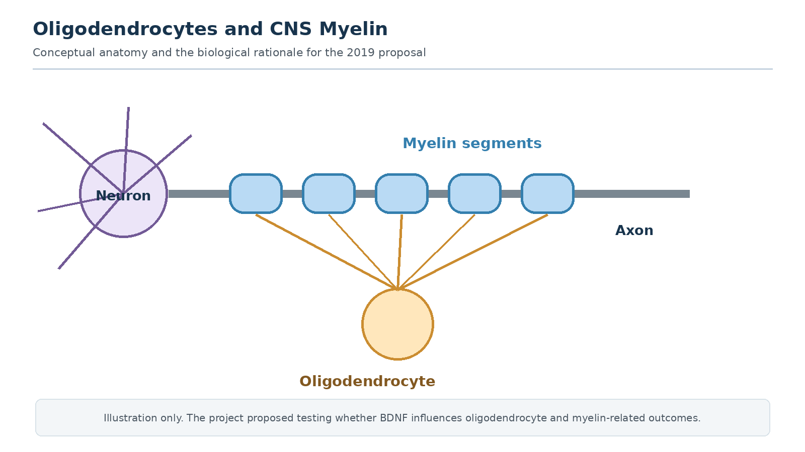
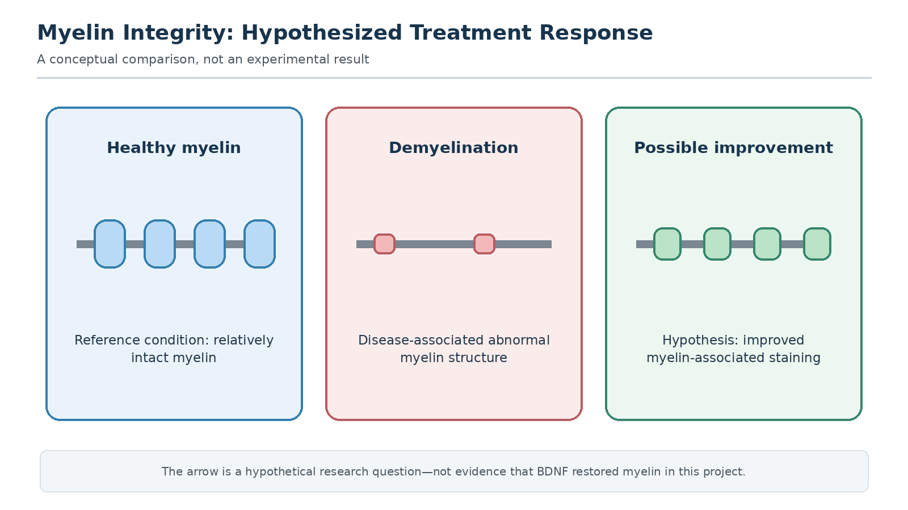

# BDNF, Oligodendrocytes & Myelin Integrity in Alzheimer’s Disease

**Independent undergraduate neuroscience research proposal · Trinity Washington University · 2019**  
**Author:** Mecca Muhammad · **Course:** NCSM 499  
**Academic outcome:** A — presented and defended before a panel of five scientists (as reported by the author).

## Start here: compare the development of the project

This repository contains **three stages of my original 2019 academic work** (an initial outline, final written proposal, and presentation) alongside **polished 2026 portfolio editions**. The original files remain unchanged to show the development of the research question, experimental planning, and scientific communication over time.

| Project stage | Original 2019 files | Polished 2026 files |
| --- | --- | --- |
| 1. Senior seminar outline | [Read PDF](originals/2019_Original_Senior_Seminar_Outline.pdf) · [Word](originals/2019_Original_Senior_Seminar_Outline.docx) | [Read PDF](polished/Senior_Seminar_Outline_Polished_2026.pdf) · [Word](polished/Senior_Seminar_Outline_Polished_2026.docx) |
| 2. Final research proposal | [Read PDF](originals/2019_Original_Research_Proposal.pdf) · [Word](originals/2019_Original_Research_Proposal.docx) | [Read PDF](polished/BDNF_Research_Proposal_Polished_2026.pdf) · [Word](polished/BDNF_Research_Proposal_Polished_2026.docx) |
| 3. Final presentation | [Read PDF](originals/2019_Original_Presentation.pdf) · [PowerPoint](originals/2019_Original_Presentation.pptx) | [Read PDF](polished/BDNF_Research_Presentation_Polished_2026.pdf) · [PowerPoint](polished/BDNF_Research_Presentation_Polished_2026.pptx) |

## Featured: 2026 research update — original hypothesis vs. later evidence

**[Read the 2026 literature update (PDF)](research-update-2026/BDNF_Research_Update_2026.pdf)** · [Editable Word](research-update-2026/BDNF_Research_Update_2026.docx) · [Study-by-study overview](research-update-2026/README.md)

In a separate retrospective review, I compare my 2019 proposed AAV-BDNF/oligodendrocyte/myelin question with selected peer-reviewed studies published in 2025–2026. The studies address **different pieces** of the question: AAV-BDNF-associated myelin changes in a **cuprizone demyelination model**; BDNF gene delivery in **APP/PS1** with transcriptomic endpoints; and oligodendrocyte-targeted **SGK1.1** intervention in **5×FAD** AD mice. These findings do **not** establish remyelination by AAV-BDNF in APP/PS1 mice or any clinical efficacy. The update is a literature synthesis, not new laboratory work.

## Research question

Could delivery of a viral vector encoding brain-derived neurotrophic factor (**AAV-BDNF**) influence oligodendrocyte maturation markers and myelin-associated staining in **APP/PS1 Alzheimer’s disease mouse models**?

This was the **proposed** hypothesis. No animal experimentation, experimental observations, treatment efficacy, or published findings are claimed for this undergraduate project.

## How the question evolved

**Initial outline (2019).** I began by examining whether changes in oligodendrocytes and cerebral white matter were associated with Alzheimer’s disease. The early experimental plan contemplated the Morris water maze and NG2 immunostaining.

**Final proposal (2019).** The project narrowed into an intervention-oriented question using proposed **AAV-BDNF** delivery. The comparison groups were treated APP/PS1 mice, untreated APP/PS1 mice, and a wild-type mouse reference group. Proposed measurements were BDNF ELISA, oligodendrocyte-associated immunostaining, and Luxol Fast Blue staining.

**Polished editions (2026).** These versions improve clarity, organization, accessibility, and scientific diagrams, and add a clearly identified *retrospective* discussion of limitations such as sample size, experimental controls, study timing, and assay specificity. They do not replace or revise the historical record of what was submitted in 2019.

## Scientific visual communication

The following **originally created conceptual schematics** appear in the polished documents. They are **illustrations, not microscopy images or experimental results**.

[View proposed experimental workflow](polished/assets/figure3_workflow.png) · [View three proposed readouts](polished/assets/figure4_three_readouts.png)

## Skills demonstrated

- Independent research-question formulation and scientific literature review
- Hypothesis development, biological methodology selection, and proposed control groups
- Scientific writing, research outlines, formal proposals, and visual technical communication
- Interpreting possible experimental outcomes and discussing study limitations
- Oral research presentation and responding to faculty questions

## Research transparency and attribution

- The historical files in [`originals/`](originals/) are preserved, unedited versions of the student submissions.
- The 2026 documents are **editorially updated portfolio versions** and include retrospective comments, not subsequent laboratory work.
- References originate from the 2019 submission; a complete modern source-verification audit has not been performed. Please consult the primary literature for scientific claims.
- The diagrams in [`polished/assets/`](polished/assets/) are explanatory schematics made for this portfolio, not third-party microscopy photographs.

**Related portfolio:** [Technical Writing Portfolio](https://github.com/MeccaMMuhammad/technical-writing-portfolio)
